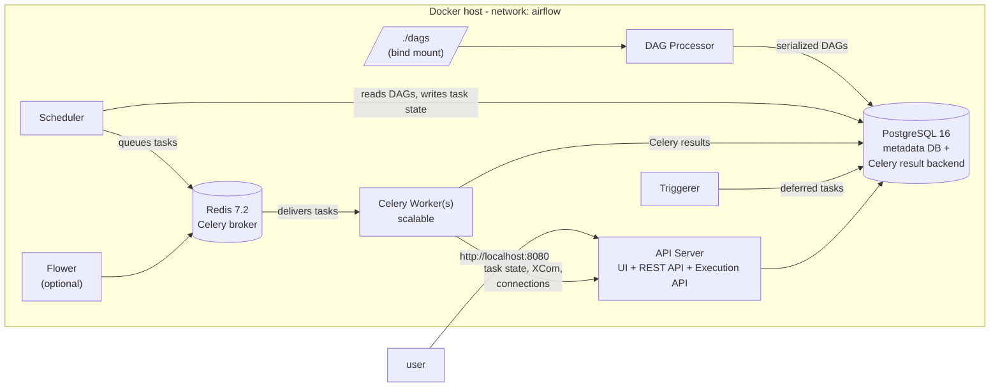
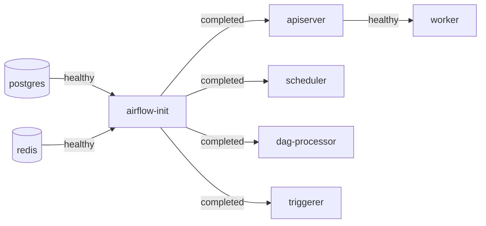
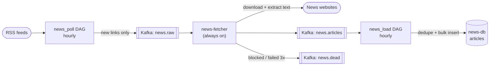

# airflow-docker

A production-style **Apache Airflow 3.3** stack that runs on a single Docker host with Docker Compose.
It uses the **CeleryExecutor**, so tasks run on separate worker containers that you can scale out.
The defaults are sized for a MacBook running Docker Desktop with 8 GB of memory, and every image runs natively on Apple Silicon (arm64) and Intel.

---

## Architecture



### How a task runs

1. **DAG Processor** reads the Python files in `./dags`, parses them, and stores the serialized DAGs in PostgreSQL. New files show up within about 30 seconds.
2. **Scheduler** reads the serialized DAGs from the database, decides which task instances are due, and pushes them onto the **Redis** queue.
3. A **Celery Worker** picks a task off the queue and runs it.
4. While the task runs, the worker talks to the **API Server's Execution API** (`/execution/`). That's how it reports state, reads and writes XComs, and fetches connections and variables. This is new in Airflow 3: task code no longer connects to the metadata database directly.
5. If an operator defers itself (an async sensor, for example), the **Triggerer** waits on the event and hands the task back to the scheduler when it fires.
6. You watch and control everything through the **API Server's UI** at `http://localhost:8080`.

### Services

| Service | Image | Role | Exposed |
|---|---|---|---|
| `postgres` | `postgres:16` | Metadata database (DAG runs, task state, users, connections) and Celery result backend | Internal only |
| `redis` | `redis:7.2` | Celery broker: the queue the scheduler pushes tasks into. Password-protected, with AOF persistence | Internal only |
| `airflow-init` | custom | One-shot job: runs `airflow db migrate`, creates the admin user, then exits | — |
| `airflow-apiserver` | custom | Web UI, REST API (`/api/v2`), and the Execution API that tasks report back to | `127.0.0.1:8080` |
| `airflow-scheduler` | custom | Decides what runs when and queues tasks. Health endpoint on `:8974` | Internal |
| `airflow-dag-processor` | custom | Parses DAG files (a separate process in Airflow 3) | Internal |
| `airflow-triggerer` | custom | Runs deferrable (async) operators and sensors | Internal |
| `airflow-worker` | custom | Celery workers that execute tasks. Scales horizontally | Internal |
| `flower` *(profile `flower`)* | custom | Celery monitoring UI, behind basic auth | `127.0.0.1:5555` |
| `airflow-cli` *(profile `debug`)* | custom | Runs one-off Airflow CLI commands | — |

**custom** is the image built from this repo's `Dockerfile`: the official `apache/airflow:3.3.1-python3.12` image plus anything listed in `requirements.txt`.

### Startup order



Every service has a healthcheck and `restart: unless-stopped`. Compose won't start a service until the services it depends on are healthy, or, for `airflow-init`, have finished successfully.

### Design choices

- **Dependencies are installed at build time.** Providers in `requirements.txt` are installed in the `Dockerfile` against Airflow's official constraints file. Nothing is pip-installed when a container starts.
- **Secrets live only in `.env`.** Compose uses `${VAR:?}` for every secret, so it refuses to start if one is missing. `.env` is gitignored.
- **Network isolation.** PostgreSQL and Redis have no published ports. The UI listens only on `127.0.0.1`; to expose it publicly, put a TLS proxy or load balancer in front.
- **Shared config.** Every Airflow service inherits the same image, environment and volumes from one YAML anchor (`x-airflow-common`), so their settings can't drift apart.
- **Graceful shutdown.** Workers get a 5-minute `stop_grace_period`, so running tasks can finish on `docker compose stop`.
- **Log rotation.** Container logs use `json-file` with a 20 MB × 5 file cap.
- **Memory caps.** Each service has a memory limit. Together they add up to about 6.8 GB, which fits in an 8 GB Docker Desktop VM.

---

## Repository layout

```
airflow-docker/
├── Dockerfile            # Custom Airflow image (official image + requirements.txt)
├── docker-compose.yaml   # All services, networks, volumes
├── requirements.txt      # Extra providers / Python libs baked into the image
├── .env.example          # Template for .env (all config + secrets)
├── dags/                 # Your DAGs (mounted read-only into containers)
│   ├── fibonacci.py          # Param-driven example: prints the first n Fibonacci numbers
│   ├── edge_extract_print.py # Fetches JSON over HTTP and summarizes it
│   ├── celery_demo.py        # Fans out 10 tasks to show distribution across workers
│   ├── news_pipeline.py      # News DAGs: news_poll (RSS -> Kafka) and news_load (Kafka -> Postgres)
│   ├── news_fetcher.py       # Always-on Kafka consumer that downloads article pages
│   ├── news_sources.py       # News sources: add a site, or a new kind of source (e.g. a crawler)
│   └── news_lib.py           # Shared topic / table setup for the news pipeline
├── plugins/              # Airflow plugins (mounted read-only)
├── config/               # Optional airflow.cfg overrides
└── RUNBOOK.md            # Operations guide: sizing, backups, upgrades, troubleshooting
```

---

## Quick start

### Prerequisites

- Docker Desktop 4.30+ (Compose v2), or Docker Engine with the Compose plugin on Linux
- Docker Desktop resources: **8 GB memory** (6 GB minimum), **4+ CPUs**, 40 GB+ disk
- On macOS, set file sharing to **VirtioFS** for fast DAG mounts

### 1. Create `.env`

```bash
cp .env.example .env
```

Replace every `CHANGE_ME` value in `.env` with a generated secret:

| Variable | Generate with |
|---|---|
| `POSTGRES_PASSWORD`, `REDIS_PASSWORD` | `openssl rand -hex 24` |
| `AIRFLOW_FERNET_KEY` | `openssl rand -base64 32 \| tr '+/' '-_'` |
| `AIRFLOW_API_SECRET_KEY`, `AIRFLOW_JWT_SECRET` | `openssl rand -hex 32` |
| `AIRFLOW_ADMIN_PASSWORD` | `openssl rand -hex 12` |
| `FLOWER_BASIC_AUTH` | `admin:` followed by `openssl rand -hex 12` |

On Linux, also set `AIRFLOW_UID` to the output of `id -u`. On macOS, keep `50000`.

> **Back up `.env`.** If you lose `AIRFLOW_FERNET_KEY`, every connection stored in Airflow becomes unreadable.

### 2. Build and start

```bash
docker compose build
```
```bash
docker compose up -d
```
```bash
docker compose ps
```

Wait until every service shows `(healthy)`. `airflow-init` should show `Exited (0)`.

### 3. Log in

Open **http://localhost:8080** and sign in as `admin` with the `AIRFLOW_ADMIN_PASSWORD` from `.env`.
DAGs start paused. Unpause one, such as `fibonacci`, and trigger it.

---

## News pipeline

A streaming pipeline that ingests news from 10 RSS feeds through **Kafka** into its own Postgres database (`news-db`), fully separate from the Airflow metadata database.



| Piece | What it does |
|---|---|
| `kafka` | Single-node Kafka 4.3 (KRaft, no ZooKeeper). Keeps messages 72 h. Only reachable inside Docker. |
| `news-db` | Postgres 16 holding only news data: tables `articles` and `seen_urls`. Open on `localhost:5433` for DB tools like DBeaver (database `news`, user `news`, password `NEWS_DB_PASSWORD` in `.env`). |
| `news_poll` | One task per source in `dags/news_sources.py`. Reads the feeds, skips URLs already in `seen_urls`, sends new links to `news.raw`. |
| `news-fetcher` | Consumer group `news-fetcher`. Obeys `robots.txt`, waits 3 s between requests to the same site, retries 3 times, then parks the link in `news.dead`. |
| `news_load` | Consumer group `news-loader`. Reads everything new in `news.articles` and inserts it. Duplicates (same URL or same headline) are dropped by unique constraints. |

**No data is lost on a crash.** Every step saves its Kafka position (offset) only after its output is safely stored, so a restart re-reads instead of skipping.

Turn it on: unpause `news_poll` and `news_load` in the UI. Then:

```bash
docker compose logs -f news-fetcher
```
```bash
docker compose exec news-db psql -U news -c "SELECT source, count(*) FROM articles GROUP BY 1"
```
```bash
docker compose exec news-db psql -U news -c "SELECT title FROM articles WHERE search @@ to_tsquery('english', 'election') LIMIT 10"
```
```bash
docker compose exec kafka /opt/kafka/bin/kafka-consumer-groups.sh --bootstrap-server localhost:9092 --describe --all-groups
```

The last command shows each consumer group's position and lag (messages still waiting) per partition.

---

## Common operations

| Task | Command |
|---|---|
| Scale workers | `docker compose up -d --scale airflow-worker=3` |
| Run an Airflow CLI command | `docker compose run --rm airflow-cli dags list` |
| Tail logs | `docker compose logs -f airflow-scheduler` |
| Start Flower | `docker compose --profile flower up -d` then open http://localhost:5555 |
| Add a provider | Add it to `requirements.txt`, then `docker compose build && docker compose up -d` |
| Back up the metadata DB | `docker compose exec -T postgres pg_dump -U airflow -d airflow -Fc > backups/airflow.dump` |
| Stop (running tasks finish) | `docker compose stop` |
| Upgrade Airflow | Back up the DB, change `AIRFLOW_VERSION` in `.env`, then `docker compose build && docker compose up -d` |

See [RUNBOOK.md](RUNBOOK.md) for sizing, restores, the hardening checklist and troubleshooting.

---

## Configuration

Everything is configured in `.env`. The most useful settings:

| Variable | Default | What it controls |
|---|---|---|
| `AIRFLOW_VERSION` | `3.3.1` | Airflow version of the base image |
| `AIRFLOW_WORKER_REPLICAS` | `1` | Number of Celery worker containers |
| `AIRFLOW_WORKER_CONCURRENCY` | `4` | Tasks each worker runs in parallel |
| `AIRFLOW_PARALLELISM` | `8` | Maximum running tasks across the whole installation |
| `AIRFLOW_API_BIND` | `127.0.0.1` | Interface the UI binds to |
| `WORKER_MEM_LIMIT` | `1536m` | Memory cap per worker; raise it if tasks are OOM-killed (exit 137) |

---

## Limitations

Everything runs on one machine. If that machine is a laptop, schedules pause whenever it sleeps or shuts down.
For pipelines that must run 24/7, deploy the same Compose stack on an always-on Linux VM; nothing in it is Mac-specific.
For real production, also consider a managed PostgreSQL, remote logging (S3/GCS), and a secrets backend. All three are covered in [RUNBOOK.md](RUNBOOK.md).
